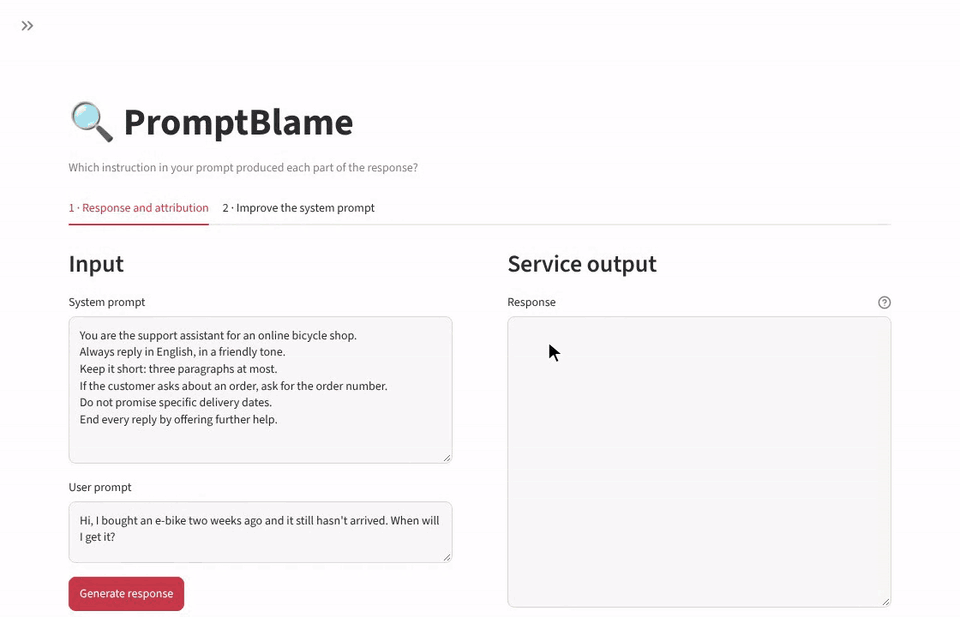
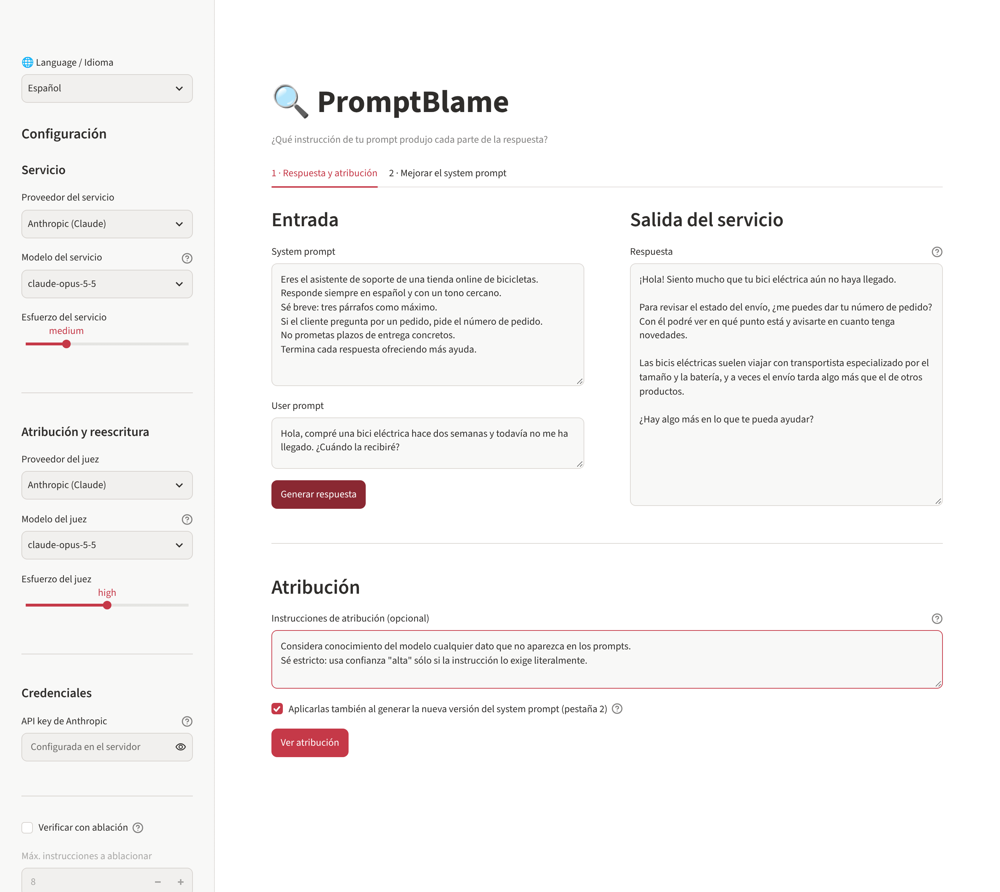
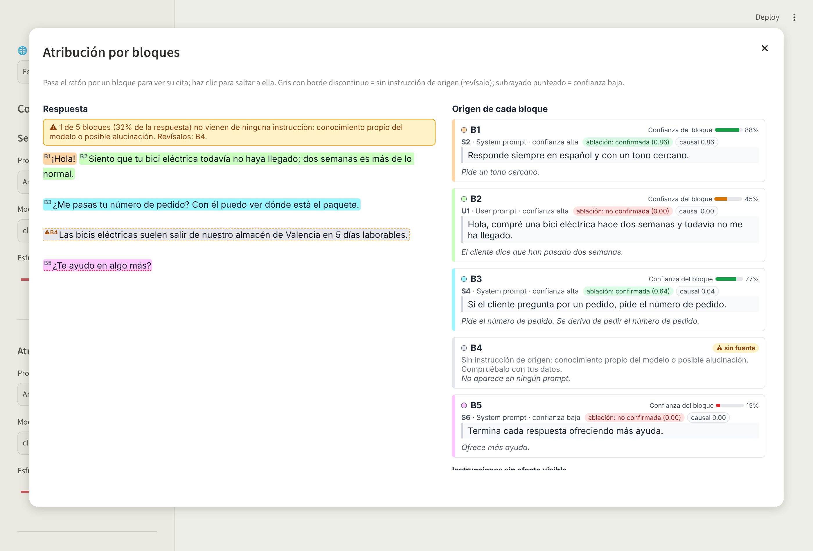
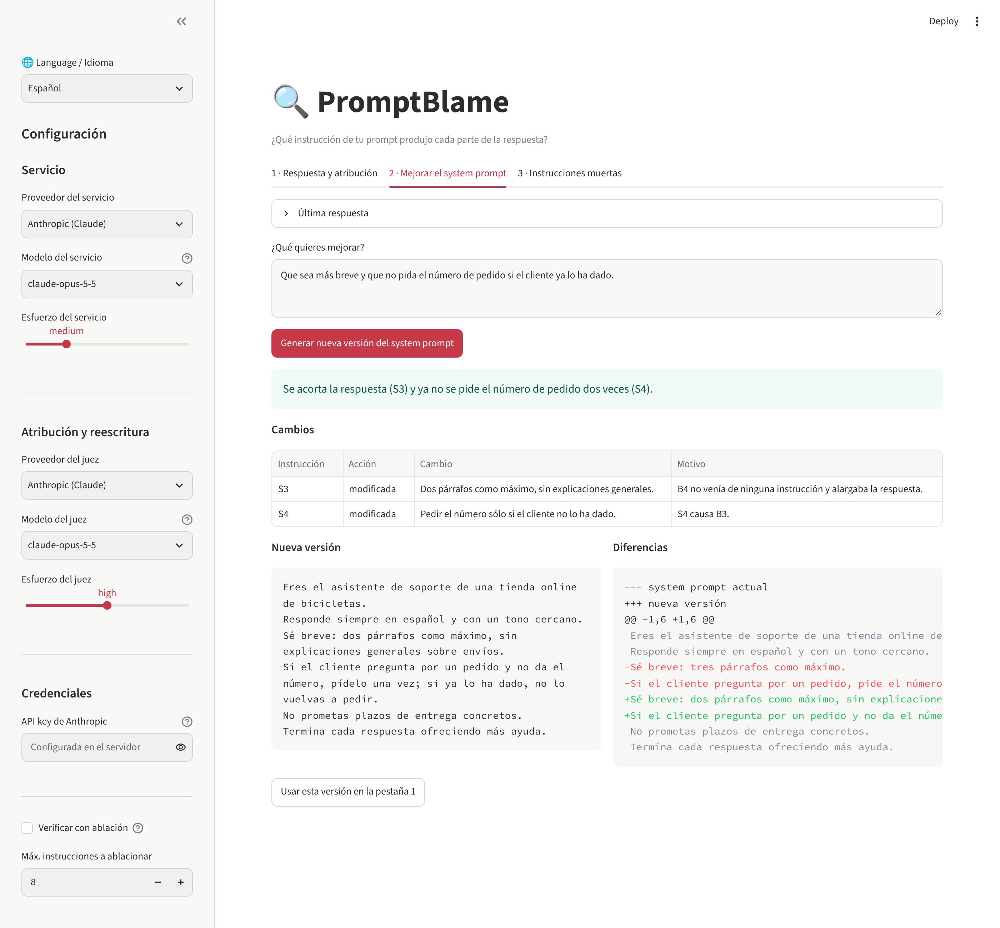
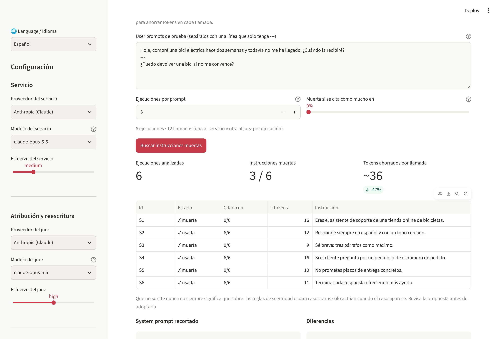
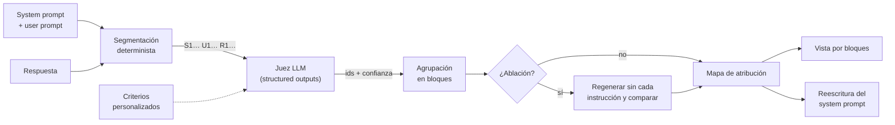

<div align="center">

# 🔍 PromptBlame

**Descubre qué instrucción de tu prompt produjo cada parte de la respuesta de un LLM.**

[English](https://github.com/marcobd3/PromptBlame/blob/main/README.md) · **Español**

[](https://github.com/marcobd3/PromptBlame/actions/workflows/tests.yml)
[](https://pypi.org/project/promptblame/)
[](https://www.python.org)
[](https://streamlit.io)
[](https://github.com/marcobd3/PromptBlame/blob/main/LICENSE)
[](https://pypistats.org/packages/promptblame)
[](#proveedores)

[Para qué sirve](#para-qué-sirve) ·
[Inicio rápido](#inicio-rápido) ·
[Uso](#uso) ·
[Cómo funciona](#cómo-funciona) ·
[Uso como librería](#uso-como-librería) ·
[CLI y API](#cli-y-api-rest) ·
[Contribuir](#contribuir)

</div>

<p align="center">
  
</p>

<p align="center"><sub>La demo usa la interfaz en inglés; se muestra en español si tu navegador lo está.</sub></p>

---

PromptBlame es un **RAG inverso para prompts**. En lugar de recuperar contexto
para generar una respuesta, parte de la respuesta y localiza qué instrucciones
del *system prompt* y del *user prompt* la causaron. Con ese mapa propone una
nueva versión del system prompt que toca sólo las instrucciones responsables.

Funciona a nivel de **instrucción** y con **modelos cerrados**: no necesita
logits, atención ni pesos, sólo la API del proveedor.

```bash
pip install "promptblame[all]" && promptblame
```

## Para qué sirve

Los system prompts largos crecen por acumulación: cada fallo añade una línea y,
al cabo de un tiempo, nadie sabe qué hace cada una. Cuando el modelo hace algo
que no quieres, PromptBlame te dice **de dónde viene**:

- **Depurar una mala respuesta.** Ves qué instrucción (o qué parte del mensaje
  del usuario) produjo la frase que no te gusta, en lugar de adivinarlo.
- **Encontrar instrucciones muertas.** Pasa varios prompts N veces y mira qué
  instrucciones no se citan nunca: lo que el modelo ignora y lo que podrías
  recortar para ahorrar tokens en cada llamada, con el prompt recortado listo
  para probar.
- **Ver lo que pone el modelo de su cosecha.** Los bloques que no vienen de
  ninguna instrucción se marcan con un aviso: conocimiento propio del modelo o
  posible alucinación.
- **Saber cuánto fiarte de cada enlace.** Cada bloque tiene una confianza y la
  ablación da a cada enlace una puntuación causal medida quitando la
  instrucción.
- **Arreglar el prompt con bisturí.** Describe el cambio que quieres y el
  reescritor toca sólo las instrucciones responsables, con una tabla de cambios
  y un diff.

Funciona con cualquier modelo detrás de una API, también los cerrados, porque
nunca necesita logits, atención ni pesos.

## Características

- **Atribución por bloques.** La respuesta se resalta en bloques de colores y
  cada uno enlaza con la cita literal del system prompt o del user prompt de la
  que procede, con su nivel de confianza y una explicación.
- **Citas siempre literales.** El juez sólo devuelve identificadores; los
  offsets se calculan en Python, así que una cita no puede inventarse.
- **Instrucciones ignoradas a la vista.** Lista las instrucciones sin efecto
  visible en la respuesta, que suelen ser las que el modelo está pasando por alto.
- **Verificación por ablación con puntuación causal (opcional).** Confirma
  cada atribución regenerando la respuesta sin la instrucción citada y
  midiendo cuánto del bloque desaparece (de 0 a 1). Se puede lanzar desde la
  propia ventana de atribución.
- **Confianza por bloque.** Una barra de confianza en cada bloque (la del juez,
  promediada con la puntuación causal tras la ablación), los bloques de
  confianza baja subrayados y un aviso con la parte de la respuesta que no
  viene de ninguna instrucción.
- **Instrucciones muertas.** La pestaña 3 pasa varios user prompts varias
  veces y lista las instrucciones del system prompt que nunca se citan, con una
  versión recortada, su diff y los tokens que ahorra por llamada.
- **CLI y API REST** para pipelines de CI y evaluaciones, con salida JSON y
  códigos de salida para usarlas como puertas de calidad.
- **Soporte de `.env`.** Las API keys y los proveedores y modelos por defecto
  se cargan de un fichero `.env` (ver `.env.example`).
- **Criterios de evaluación propios.** Una caja de instrucciones personalizadas
  para decirle al juez cómo evaluar: qué cuenta como causa, qué ignorar, cómo
  de estricto ser.
- **Mejora guiada del system prompt.** Describe lo que quieres cambiar y
  obtienes una nueva versión, la tabla de cambios y el diff.
- **Multiproveedor.** Claude (por defecto), OpenAI, Google Gemini y cualquier
  endpoint compatible con la API de OpenAI (Ollama, OpenRouter, Mistral, Groq,
  vLLM, LM Studio…). El modelo que responde y el modelo juez se eligen por
  separado.
- **Tema claro y oscuro**, siguiendo el de Streamlit.
- **Interfaz en inglés y en español.** Se muestra en español si el navegador
  está en español y en inglés en cualquier otro caso; se puede cambiar en la
  barra lateral. El juez y el reescritor redactan sus explicaciones en el mismo
  idioma.

## Inicio rápido

Requisitos: Python 3.11 o superior y una API key del proveedor que vayas a usar
(o un servidor local como Ollama, que no la necesita).
PromptBlame está publicado en [PyPI](https://pypi.org/project/promptblame/), así
que se instala con `pip`:

```bash
python -m venv .venv && source .venv/bin/activate
pip install "promptblame[all]"
export ANTHROPIC_API_KEY="sk-ant-..."   # o usa un .env, o escríbela en la barra lateral
promptblame
```

La app se abre en <http://localhost:8501> con un ejemplo cargado. Los
argumentos se pasan a Streamlit, p. ej. `promptblame --server.port 8600`.

### Configuración con `.env`

Copia [`.env.example`](https://github.com/marcobd3/PromptBlame/blob/main/.env.example)
a `.env` en la carpeta desde la que lanzas PromptBlame y rellena lo que
necesites. La interfaz, la CLI y la API REST lo cargan al arrancar; las
variables que ya estén definidas en el entorno tienen prioridad.

```dotenv
ANTHROPIC_API_KEY=sk-ant-...
PROMPTBLAME_SERVICE_PROVIDER=openai
PROMPTBLAME_SERVICE_MODEL=gpt-6.1-sol
PROMPTBLAME_JUDGE_MODEL=claude-opus-5-5
PROMPTBLAME_JUDGE_EFFORT=high
PROMPTBLAME_ABLATION=true
```

Las keys del `.env` se usan en el servidor y **no** se copian en los campos de
la barra lateral (lo que hay en un campo llega al navegador); en su lugar el
campo muestra «Configurada en el servidor». Proveedores, modelos, esfuerzos,
idioma y ablación pasan a ser los valores iniciales de la barra lateral.

### ¿Sin API key? Usa un modelo local

PromptBlame habla con cualquier servidor compatible con OpenAI, así que
funciona sin conexión con [Ollama](https://ollama.com):

```bash
ollama pull llama3.2
pip install "promptblame[app]"
promptblame
```

En la barra lateral, elige **Compatible con OpenAI** como proveedor del
servicio y del juez, y escribe el nombre del modelo (`llama3.2`). La URL base
es la de Ollama por defecto (`http://localhost:11434/v1`). También puedes
combinarlos: responde un modelo local y juzga Claude.

### Extras

El paquete base trae la librería y los SDK de Anthropic y de OpenAI, así que
funciona con Claude, OpenAI y cualquier endpoint compatible con OpenAI (Ollama,
OpenRouter, Mistral, vLLM…). Añade lo que necesites:

```bash
pip install promptblame                    # librería: Claude, OpenAI y compatibles
pip install "promptblame[app]"             # + interfaz de Streamlit (comando promptblame)
pip install "promptblame[gemini]"          # + Google Gemini
pip install "promptblame[api]"             # + API REST (FastAPI, promptblame serve)
pip install "promptblame[all]"             # todo
```

### Desde el código fuente

```bash
git clone https://github.com/marcobd3/PromptBlame.git
cd PromptBlame
pip install -e ".[all]"
streamlit run app.py
```

`streamlit run app.py` ejecuta siempre el código de `src/`, aunque haya otro
`promptblame` instalado. `requirements.txt` instala el repositorio con todos los extras, para
plataformas que sólo leen ese archivo (p. ej. Streamlit Community Cloud).

## Uso

### 1 · Respuesta y atribución

<p align="center">
  
</p>

La entrada está a la izquierda, la salida del servicio a la derecha y, debajo de
las dos, la sección de atribución.

1. Escribe un system prompt y un user prompt, y pulsa **Generar respuesta**.
   La respuesta aparece a la derecha, en la caja de salida; también puedes
   pegar ahí una respuesta que ya tengas.
2. En la sección **Atribución**, debajo, añade si quieres tus instrucciones de
   atribución y pulsa **Ver atribución**. Se abre una ventana con la respuesta dividida en
   bloques de colores y, a la derecha, la cita de la que procede cada bloque.
   Al pasar el ratón por un bloque se resalta su cita; al hacer clic se salta a ella.
3. Cada tarjeta muestra la **confianza** del bloque; los de confianza baja se
   subrayan en la respuesta. Los bloques sin instrucción de origen salen en
   gris con un ⚠, y un aviso arriba dice cuáles son y qué parte de la respuesta
   ocupan: conocimiento propio del modelo o posible alucinación, conviene
   revisarlos.
4. **Verificar estos enlaces por ablación** (o la casilla de la barra lateral)
   regenera la respuesta sin cada instrucción citada y añade a cada enlace una
   marca *confirmada / no confirmada* y una **puntuación causal**.

<p align="center">
  
</p>

### 2 · Mejorar el system prompt

<p align="center">
  
</p>

Toma la última respuesta, la mejora que describas y el mapa de atribución, y
genera una nueva versión del system prompt con un resumen, la tabla de cambios
(qué instrucción se modifica, elimina o añade y por qué) y el diff. Con **Usar
esta versión en la pestaña 1** pasas a probarla; las versiones anteriores
quedan guardadas en la sesión.

### 3 · Instrucciones muertas

<p align="center">
  
</p>

Pega varios user prompts realistas (separados por una línea que sólo tenga
`---`), elige cuántas ejecuciones por prompt y pulsa **Buscar instrucciones
muertas**. Cada ejecución genera una respuesta y la atribuye; la tabla muestra
en cuántas ejecuciones se citó cada instrucción del system prompt. Las que no
se citan nunca (o como mucho en la fracción de ejecuciones elegida) se
proponen para quitar, con el prompt recortado, su diff y los tokens que se
ahorran por llamada. **Usar esta versión en la pestaña 1** la adopta.

Que no se cite nunca no siempre significa que sobre: una regla de seguridad o
para casos raros sólo actúa cuando el caso aparece, así que usa prompts
variados y revisa la propuesta. Cada ejecución cuesta dos llamadas (servicio y
juez).

### Instrucciones personalizadas de evaluación

En la sección **Atribución** de la pestaña 1 hay una caja opcional para dar al
juez contexto y criterios propios. Por ejemplo:

```text
- El tono y el idioma sólo cuentan como causa si la respuesta se aparta de lo habitual.
- Considera conocimiento del modelo cualquier dato que no aparezca en los prompts.
- Sé estricto: usa confianza "alta" sólo si la instrucción lo exige literalmente.
```

Los criterios se añaden al prompt del juez de atribución y, si dejas marcada la
casilla, también al de la reescritura del system prompt. Cambiarlos invalida la
atribución en caché, así que la siguiente consulta se evalúa con los nuevos
criterios. El formato de salida y la regla de citar sólo identificadores
existentes se mantienen siempre.

### Configuración

Todo se ajusta en la barra lateral:

| Opción | Por defecto | Descripción |
|---|---|---|
| Idioma | el del navegador (inglés si no es español) | Idioma de la interfaz y de las explicaciones del juez y del reescritor. |
| Proveedor y modelo del servicio | Anthropic, `claude-opus-5-5` | Genera la respuesta que se analiza y las regeneraciones de la ablación. |
| Esfuerzo del servicio | `medium` | Esfuerzo de razonamiento de la generación. |
| Proveedor y modelo del juez | Anthropic, `claude-opus-5-5` | Juez de atribución y reescritor del system prompt. |
| Esfuerzo del juez | `high` | Más esfuerzo, atribuciones más finas. |
| Credenciales | variables de entorno | API key de cada proveedor en uso y, para el endpoint compatible, su URL base. |
| Verificar con ablación | desactivado | Confirma cada atribución regenerando sin la instrucción. |
| Máx. instrucciones a ablacionar | `8` | Límite de regeneraciones (se eligen las más citadas). |

Todos los valores por defecto de esta tabla se pueden fijar en el `.env` (ver
[Configuración con `.env`](#configuración-con-env)).

El servicio y el juez son independientes: puedes analizar la respuesta de un
modelo local de Ollama con Claude como juez, o comparar cómo atribuyen dos
proveedores la misma respuesta. La lista de modelos es una sugerencia; se
puede escribir cualquier otro identificador.

### Proveedores

| Proveedor | Variable de entorno | Salida estructurada del juez | Esfuerzo |
|---|---|---|---|
| Anthropic (Claude) | `ANTHROPIC_API_KEY` | `output_config.format` con JSON Schema | `output_config.effort` |
| OpenAI | `OPENAI_API_KEY` | `response_format` `json_schema` estricto | `reasoning_effort` |
| Google Gemini | `GEMINI_API_KEY` o `GOOGLE_API_KEY` | `response_json_schema` | `thinking_level` |
| Compatible con OpenAI | `OPENAI_COMPATIBLE_API_KEY` (opcional), `OPENAI_COMPATIBLE_BASE_URL` | `json_schema` → `json_object` → esquema en el prompt | no se envía |

URLs base habituales para el endpoint compatible:

| Servicio | URL base |
|---|---|
| Ollama (por defecto) | `http://localhost:11434/v1` |
| OpenRouter | `https://openrouter.ai/api/v1` |
| Mistral | `https://api.mistral.ai/v1` |
| Groq | `https://api.groq.com/openai/v1` |

Con Claude Opus 5.5, Fable 5.2 y Sonnet 5.5 se activan los *fallbacks* del
servidor: si el clasificador de seguridad rechaza una petición, la API la
reintenta con otro modelo en la misma llamada.

## Cómo funciona



**1. Segmentación.** Los prompts se dividen de forma determinista en
instrucciones (líneas, viñetas y frases: `S1, S2…` para el system prompt,
`U1, U2…` para el user prompt) y la respuesta en segmentos (`R1, R2…`), con
sus offsets exactos en el texto original.

**2. Juez LLM.** Un modelo juez recibe todas las unidades numeradas y devuelve,
mediante *structured outputs*, las fuentes de cada segmento con una confianza
(alta, media o baja) y una explicación en el idioma elegido. Como el modelo sólo devuelve
identificadores, las citas son siempre literales; los identificadores que no
existen se descartan. Los segmentos contiguos de un mismo párrafo con las
mismas fuentes se agrupan en bloques.

**3. Verificación por ablación (opcional).** Por cada instrucción citada se
regenera la respuesta *sin* esa instrucción y se mide cuánto cambia cada bloque
que la cita:

$$\text{efecto}(B, S) = \text{sim}(B, \text{control}) - \text{sim}(B, \text{sin } S)$$

donde *control* es otra generación con el prompt completo, lo que descuenta la
variación natural entre generaciones. Un efecto ≥ 0,15 marca la atribución como
**confirmada**. La **puntuación causal** lo normaliza por la similitud con el
control, $\text{efecto} / \text{sim}(B, \text{control})$: la fracción del bloque
que desaparece sin la instrucción (1 = entero, 0 = nada). Cuesta una llamada
por instrucción más una de control, en paralelo.

**Confianza del bloque.** La confianza del juez en la fuente más fiable del
bloque (alta 0,9, media 0,6, baja 0,3), promediada con la mayor puntuación
causal si se hizo la ablación. Los bloques sin fuente no tienen confianza y se
informan como sin fuente, junto con la parte de la respuesta que ocupan.

**Instrucciones muertas.** Se cuentan las citas de cada instrucción en N
ejecuciones atribuidas del mismo system prompt; las que se citan como mucho en
la fracción elegida se quitan (la línea entera, o la frase dentro de la línea)
para construir el prompt recortado. Los tokens se estiman a unos 4 caracteres
cada uno.

**4. Reescritura.** El mapa de atribución (bloques, causas, confianza, efecto de
ablación e instrucciones sin efecto) se pasa al reescritor junto con la mejora
pedida. El reescritor cambia primero las instrucciones que causan los bloques
afectados, refuerza las que no tuvieron efecto y deja intacto lo demás.

## Arquitectura

```text
PromptBlame/
├── app.py                        # Atajo para `streamlit run app.py` desde el repositorio
├── .env.example                  # Plantilla de API keys y valores por defecto
├── src/promptblame/
│   ├── __init__.py               # API pública y versión
│   ├── segmentation.py           # Segmentación determinista en unidades con offsets
│   ├── llm.py                    # Cliente multiproveedor: texto y JSON estructurado
│   ├── attribution.py            # Juez LLM, agrupación en bloques y ablación
│   ├── rewrite.py                # Reescritura del system prompt y diff
│   ├── dead.py                   # Instrucciones muertas en N ejecuciones y recorte
│   ├── config.py                 # Carga del .env y valores por defecto del entorno
│   ├── api.py                    # API REST con FastAPI (extra [api])
│   ├── render.py                 # Vista HTML de bloques de colores y citas
│   ├── app.py                    # Interfaz de Streamlit (extra [app])
│   ├── i18n.py                   # Textos de la interfaz en inglés y español
│   └── cli.py                    # Comando `promptblame`: interfaz, subcomandos y `serve`
├── tests/                        # Tests con los clientes de los proveedores simulados
└── docs/                         # Capturas (en inglés; en español, en docs/es/)
```

La librería no depende de Streamlit: la interfaz es una capa fina sobre ella y
se instala con el extra `[app]`.

## Uso como librería

```python
from promptblame import LLM, attribute, rewrite_system_prompt, unified_diff, verify_by_ablation

judge = LLM(model="claude-opus-5-5")  # lee ANTHROPIC_API_KEY
service = LLM(model="gpt-6.1-sol", provider="openai")

system_prompt = "Eres un asistente de soporte.\nResponde siempre en español."
user_prompt = "¿Dónde está mi pedido?"
response = service.text(system_prompt, user_prompt)

attr = attribute(
    judge,
    system_prompt,
    user_prompt,
    response,
    instructions="Considera conocimiento del modelo cualquier dato que no esté en los prompts.",
    language="es",  # idioma de las explicaciones; por defecto "en"
)
verify_by_ablation(service, attr)  # opcional

for block in attr.blocks:
    sources = ", ".join(f"{link.unit.id} ({link.confidence})" for link in block.sources)
    print(f"{block.id}: {block.text!r} ← {sources or 'conocimiento del modelo'}")

print("Sin efecto:", [u.id for u in attr.unused_sources])

print("Sin fuente:", [b.id for b in attr.unsourced_blocks], f"{attr.unsourced_share:.0%}")
print("Confianza por bloque:", {b.id: b.confidence_score for b in attr.blocks})

result = rewrite_system_prompt(judge, attr, "Que pida el número de pedido.")
print(unified_diff(system_prompt, result.new_system_prompt))

# Instrucciones muertas con varios prompts y ejecuciones
from promptblame import scan_dead_instructions

report = scan_dead_instructions(
    service, judge, system_prompt, ["¿Dónde está mi pedido?", "¿Puedo devolverlo?"], runs_per_prompt=3
)
print([u.unit.id for u in report.dead], report.tokens_saved)
print(report.trimmed_system_prompt)

attr.to_dict()  # serializable a JSON, igual que report.to_dict()
```

## CLI y API REST

Las mismas funciones se pueden usar sin la interfaz, para meterlas en
pipelines de CI y en baterías de evaluación. Los prompts se leen de ficheros
(`-` = entrada estándar), el `.env` se carga igual que en la interfaz y
`--json` imprime el resultado completo.

```bash
# Atribuir una respuesta (o dejar que la genere el servicio si se omite -r)
promptblame attribute -s system.txt -u user.txt -r respuesta.txt --json -o atribucion.json

# Romper el build si más del 20 % de la respuesta no viene de ninguna
# instrucción o si algún bloque tiene confianza menor de 0,5 (código 3)
promptblame attribute -s system.txt -u user.txt --ablation --fail-on-unsourced 0.2 --min-confidence 0.5

# Instrucciones muertas con 3 ejecuciones de cada prompt (.jsonl o texto separado por líneas ---)
promptblame dead -s system.txt -u prompts.jsonl --runs 3 --write-trimmed system.recortado.txt --fail-on-dead

# Nueva versión del system prompt
promptblame rewrite -s system.txt -u user.txt -i "No pidas el número de pedido dos veces" -o system.nuevo.txt
```

Los modelos se eligen con `--provider/--model/--effort` (servicio) y
`--judge-provider/--judge-model/--judge-effort` (juez); por defecto, los del
`.env`. Códigos de salida: 0 bien, 1 error, 2 argumentos incorrectos, 3 falló
una comprobación `--fail-on-*`.

**API REST.** `pip install "promptblame[api]"` y `promptblame serve` arrancan
un servidor FastAPI en `http://127.0.0.1:8000` (documentación interactiva en
`/docs`):

| Endpoint | Cuerpo (JSON) | Devuelve |
|---|---|---|
| `GET /health` | | estado y versión |
| `POST /generate` | `system_prompt`, `user_prompt`, `service` | `response` |
| `POST /attribute` | `system_prompt`, `user_prompt`, `response`?, `judge`, `service`, `instructions`, `language`, `ablation`, `max_ablation` | la atribución (`Attribution.to_dict()`) |
| `POST /rewrite` | lo mismo + `improvement` | `new_system_prompt`, `changes`, `summary`, `diff`, `attribution` |
| `POST /dead-instructions` | `system_prompt`, `user_prompts`, `runs_per_prompt`, `threshold` | uso de cada instrucción, `dead`, `trimmed_system_prompt`, `tokens_saved` |

`service` y `judge` son `{"provider", "model", "effort"}`, todos opcionales
(por defecto, los del `.env`). Las API keys y la URL del endpoint compatible
salen **sólo** del entorno del servidor, nunca de la petición. Con
`PROMPTBLAME_API_TOKEN` se exige `Authorization: Bearer <token>`.

```bash
curl -s localhost:8000/attribute -H 'content-type: application/json' \
  -d '{"system_prompt": "Responde en español.", "user_prompt": "Hello", "language": "es"}'
```


## Desarrollo

```bash
pip install -e ".[all]" --group dev   # pip 25.1 o superior
ruff check . && ruff format --check .
mypy
pytest
```

Los tests simulan los clientes de cada proveedor, así que no necesitan API key
ni gastan tokens. Cubren la segmentación, el juez, la agrupación en bloques, la
ablación, la reescritura, la vista HTML, la confianza por bloque, las instrucciones muertas, el `.env`, la
CLI, la API REST, los cuatro proveedores, los casos de seguridad y un recorrido completo de la interfaz con `streamlit.testing`. En
GitHub Actions se ejecutan con Python 3.11 a 3.13, junto con ruff, mypy y la
construcción del paquete, en cada *push* y *pull request*.

### Publicar una versión

1. Sube `__version__` en `src/promptblame/__init__.py` y anota los cambios en
   `CHANGELOG.md`.
2. Crea en GitHub una release con la etiqueta `vX.Y.Z` (la misma versión).
3. El workflow `publish.yml` construye el paquete y lo publica en PyPI con
   *Trusted Publishing*, sin tokens guardados. Falla si la etiqueta no coincide
   con la versión.

## Seguridad

- **API keys.** Las keys del entorno (`ANTHROPIC_API_KEY`, etc.) se leen en el
  servidor y nunca se envían al navegador. Las que se escriben en la barra
  lateral sólo viven en la sesión de Streamlit y no se guardan ni se registran.
- **Despliegues públicos.** Si publicas la app con una key en el entorno,
  cualquier visitante gastará tu cuota. En ese caso no definas keys en el
  servidor y deja que cada usuario escriba la suya, o protege la app con
  autenticación. El proveedor «compatible» hace que el servidor llame a la URL
  que escriba el usuario (sólo `http`/`https`); no lo expongas en una red con
  servicios internos.
- **API REST.** Escucha en `127.0.0.1` por defecto. Las keys de los
  proveedores y la URL del endpoint compatible salen sólo del entorno del
  servidor, así que un cliente no puede hacer que el servidor llame a una URL
  cualquiera. Define `PROMPTBLAME_API_TOKEN` antes de exponerla en una red.
- **`.env`.** Está en `.gitignore`; no lo subas nunca. Las keys que se cargan
  de él se quedan en el servidor como cualquier otra variable de entorno.
- **Contenido no confiable.** Prompts y respuestas se escapan en la vista HTML,
  la respuesta se muestra como texto (no como Markdown, para que no cargue
  imágenes externas) y la salida JSON de los modelos se valida antes de usarla.
  Los prompts del juez y del reescritor les indican que traten el contenido
  analizado como datos, aunque ningún modelo es inmune a la inyección de
  prompts.

Para informar de una vulnerabilidad, consulta [SECURITY.md](https://github.com/marcobd3/PromptBlame/blob/main/SECURITY.md).

## Limitaciones conocidas

- La atribución del juez es una hipótesis del propio modelo. La ablación la
  contrasta, pero mide similitud léxica, no semántica, a partir de una sola
  generación de control, así que la puntuación causal es ruidosa en bloques
  muy cortos.
- Sin ablación, la confianza del bloque es la que declara el juez, no una
  probabilidad calibrada.
- Las instrucciones redundantes pueden no superar la ablación aunque influyan:
  si dos instrucciones piden lo mismo, quitar una sola no cambia la respuesta.
- La segmentación por frases es heurística y está pensada para español e inglés.
- Con modelos pequeños o sin salida estructurada estricta, el juez puede
  devolver identificadores de más o de menos; se descartan los que no existen
  y se avisa de los segmentos sin atribución.

## Contribuir

Las *issues* y *pull requests* son bienvenidas, desde avisos de fallos hasta
proveedores nuevos. Algunas áreas donde la ayuda es especialmente útil:

- Similitud semántica para la verificación por ablación (hoy es léxica).
- Segmentación para idiomas distintos del español y el inglés.
- Benchmarks: prompts con una causa conocida, para medir cuántas veces acierta el juez.
- Exportar el mapa de atribución (JSON, informe HTML).

Para empezar, sigue [Desarrollo](#desarrollo): instala con
`pip install -e ".[all]" --group dev` y, antes de abrir una PR, ejecuta `ruff`,
`mypy` y `pytest` y añade tests para el comportamiento nuevo. Los tests simulan
los proveedores, así que no necesitas API key.

Si PromptBlame te ha ayudado a entender un prompt, una ⭐ en GitHub ayuda a que
otras personas lo encuentren.

## Licencia

Distribuido bajo la licencia [GNU AGPL-3.0](https://github.com/marcobd3/PromptBlame/blob/main/LICENSE). Si ofreces una versión
modificada de PromptBlame como servicio en red, debes publicar el código fuente
de tus cambios.
