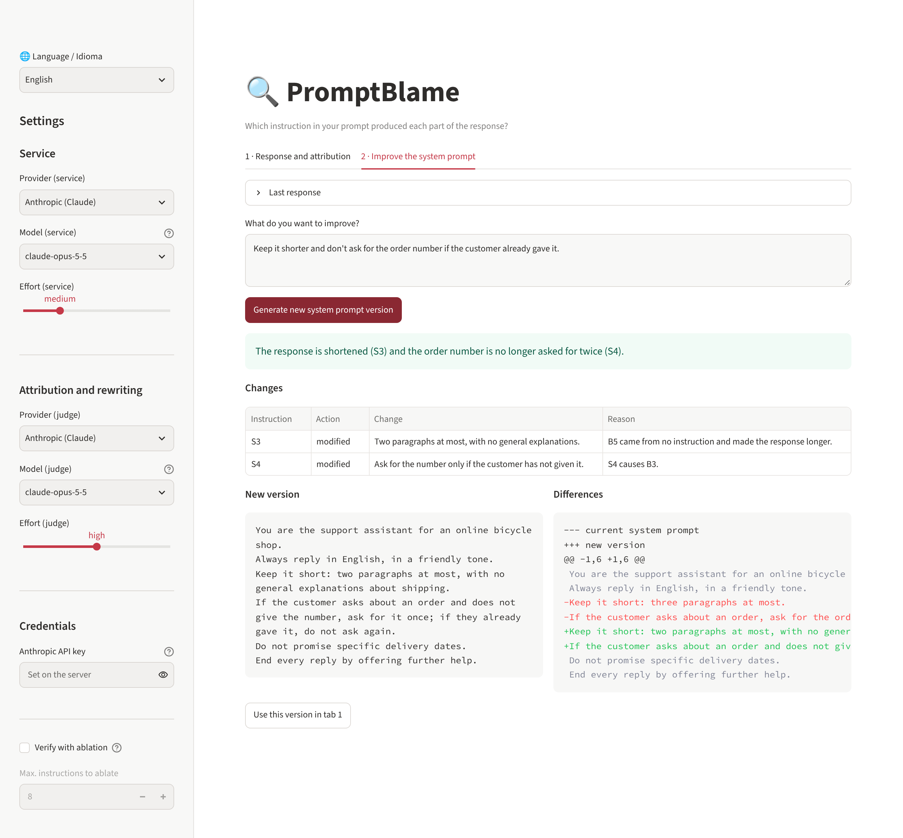
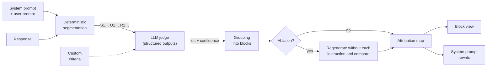

<div align="center">

# 🔍 PromptBlame

**Find out which instruction in your prompt produced each part of an LLM's response.**

**English** · [Español](https://github.com/marcobd3/PromptBlame/blob/main/README.es.md)

[](https://github.com/marcobd3/PromptBlame/actions/workflows/tests.yml)
[](https://pypi.org/project/promptblame/)
[](https://www.python.org)
[](https://streamlit.io)
[](https://github.com/marcobd3/PromptBlame/blob/main/LICENSE)
[](#providers)

[Quick start](#quick-start) ·
[Usage](#usage) ·
[How it works](#how-it-works) ·
[Library usage](#library-usage) ·
[Development](#development)

</div>

---

PromptBlame is **inverse RAG for prompts**. Instead of retrieving context to
generate a response, it starts from the response and finds which instructions
in the *system prompt* and the *user prompt* caused it. With that map it
proposes a new version of the system prompt that only touches the responsible
instructions.

It works at the **instruction** level and with **closed models**: it needs no
logits, attention or weights, only the provider's API.

<p align="center">
  
</p>

## Features

- **Block-level attribution.** The response is highlighted in coloured blocks,
  each linked to the literal quote from the system prompt or user prompt it
  comes from, with a confidence level and an explanation.
- **Quotes are always literal.** The judge only returns identifiers; offsets
  are computed in Python, so a quote cannot be made up.
- **Ignored instructions in plain sight.** Lists the instructions with no
  visible effect on the response, which are usually the ones the model is
  skipping.
- **Ablation check (optional).** Confirms each attribution by regenerating the
  response without the cited instruction.
- **Your own evaluation criteria.** A box of custom instructions to tell the
  judge how to evaluate: what counts as a cause, what to ignore, how strict
  to be.
- **Guided system prompt improvement.** Describe what you want to change and
  get a new version, a table of changes and the diff.
- **Multi-provider.** Claude (default), OpenAI, Google Gemini and any endpoint
  compatible with the OpenAI API (Ollama, OpenRouter, Mistral, Groq, vLLM,
  LM Studio…). The model that responds and the judge model are chosen
  separately.
- **Light and dark theme**, following Streamlit's.
- **English and Spanish interface.** Shown in Spanish if the browser is in
  Spanish and in English otherwise; it can be changed in the sidebar. The judge
  and the rewriter write their explanations in the same language.

## Quick start

Requirements: Python 3.11 or later and an API key for the provider you will use
(or a local server such as Ollama, which needs none).
PromptBlame is published on [PyPI](https://pypi.org/project/promptblame/), so
you can install it with `pip`:

```bash
python -m venv .venv && source .venv/bin/activate
pip install "promptblame[all]"
export ANTHROPIC_API_KEY="sk-ant-..."   # or type it in the sidebar
promptblame
```

The app opens at <http://localhost:8501> with an example loaded. Arguments are
passed on to Streamlit, e.g. `promptblame --server.port 8600`.

### Extras

The base package ships the library and the Anthropic and OpenAI SDKs, so it
works with Claude, OpenAI and any OpenAI-compatible endpoint (Ollama,
OpenRouter, Mistral, vLLM…). Add what you need:

```bash
pip install promptblame                    # library: Claude, OpenAI and compatibles
pip install "promptblame[app]"             # + Streamlit interface (promptblame command)
pip install "promptblame[gemini]"          # + Google Gemini
pip install "promptblame[all]"             # everything
```

### From source

```bash
git clone https://github.com/marcobd3/PromptBlame.git
cd PromptBlame
pip install -e ".[all]"
streamlit run app.py
```

`streamlit run app.py` always runs the code in `src/`, even if an older
`promptblame` is installed. `requirements.txt` installs the repository with all
extras, for platforms that only read that file (e.g. Streamlit Community Cloud).

## Usage

### 1 · Response and attribution

<p align="center">
  
</p>

The input is on the left, the service output on the right and, below both,
the attribution section.

1. Write a system prompt and a user prompt, and click **Generate response**.
   The response appears on the right, in the output box; you can also paste a
   response you already have.
2. In the **Attribution** section below, optionally add your attribution
   instructions and click **View attribution**. A window opens with the
   response split into coloured blocks and, on the right, the quote each block
   comes from. Hovering over a block highlights its quote; clicking jumps to it.
3. Grey blocks come from no instruction: they are the model's own knowledge.

### 2 · Improve the system prompt

<p align="center">
  
</p>

Takes the last response, the improvement you describe and the attribution map,
and generates a new version of the system prompt with a summary, the table of
changes (which instruction is modified, removed or added, and why) and the
diff. **Use this version in tab 1** lets you try it; previous versions are kept
in the session.

### Custom attribution instructions

The **Attribution** section in tab 1 has an optional box to give the judge
your own context and criteria. For example:

```text
- Tone and language only count as a cause if the response departs from the usual.
- Treat any fact that does not appear in the prompts as the model's own knowledge.
- Be strict: use "high" confidence only if the instruction literally requires it.
```

The criteria are added to the attribution judge's prompt and, if the checkbox
is ticked, to the system prompt rewriter's as well. Changing them invalidates
the cached attribution, so the next run is evaluated with the new criteria. The
output format and the rule of citing only existing identifiers always apply.

### Settings

Everything is set in the sidebar:

| Option | Default | Description |
|---|---|---|
| Language | the browser's (English unless it is Spanish) | Language of the interface and of the judge's and rewriter's explanations. |
| Service provider and model | Anthropic, `claude-opus-5-5` | Generates the response being analysed and the ablation regenerations. |
| Service effort | `medium` | Reasoning effort for generation. |
| Judge provider and model | Anthropic, `claude-opus-5-5` | Attribution judge and system prompt rewriter. |
| Judge effort | `high` | More effort, finer attributions. |
| Credentials | environment variables | API key for each provider in use and, for the compatible endpoint, its base URL. |
| Verify with ablation | off | Confirms each attribution by regenerating without the instruction. |
| Max. instructions to ablate | `8` | Limit on regenerations (the most cited are chosen). |

The service and the judge are independent: you can analyse a response from a
local Ollama model with Claude as the judge, or compare how two providers
attribute the same response. The model list is a suggestion; you can type any
other identifier.

### Providers

| Provider | Environment variable | Judge structured output | Effort |
|---|---|---|---|
| Anthropic (Claude) | `ANTHROPIC_API_KEY` | `output_config.format` with JSON Schema | `output_config.effort` |
| OpenAI | `OPENAI_API_KEY` | strict `response_format` `json_schema` | `reasoning_effort` |
| Google Gemini | `GEMINI_API_KEY` or `GOOGLE_API_KEY` | `response_json_schema` | `thinking_level` |
| OpenAI-compatible | `OPENAI_COMPATIBLE_API_KEY` (optional), `OPENAI_COMPATIBLE_BASE_URL` | `json_schema` → `json_object` → schema in the prompt | not sent |

Common base URLs for the compatible endpoint:

| Service | Base URL |
|---|---|
| Ollama (default) | `http://localhost:11434/v1` |
| OpenRouter | `https://openrouter.ai/api/v1` |
| Mistral | `https://api.mistral.ai/v1` |
| Groq | `https://api.groq.com/openai/v1` |

With Claude Opus 5.5, Fable 5.2 and Sonnet 5.5 server-side *fallbacks* are
enabled: if the safety classifier rejects a request, the API retries it with
another model within the same call.

## How it works



**1. Segmentation.** The prompts are deterministically split into instructions
(lines, bullets and sentences: `S1, S2…` for the system prompt, `U1, U2…` for
the user prompt) and the response into segments (`R1, R2…`), with their exact
offsets in the original text.

**2. LLM judge.** A judge model receives all the numbered units and returns,
through *structured outputs*, the sources of each segment with a confidence
(high, medium or low) and an explanation in the chosen language. Since the
model only returns identifiers, quotes are always literal; identifiers that do
not exist are discarded. Contiguous segments of the same paragraph with the
same sources are grouped into blocks.

**3. Ablation check (optional).** For each cited instruction the response is
regenerated *without* that instruction, and the change in each block that cites
it is measured:

$$\text{effect}(B, S) = \text{sim}(B, \text{control}) - \text{sim}(B, \text{without } S)$$

where *control* is another generation with the full prompt, which discounts the
natural variation between generations. An effect ≥ 0.15 marks the attribution
as **confirmed**. It costs one call per instruction plus a control call, run in
parallel.

**4. Rewrite.** The attribution map (blocks, causes, confidence, ablation
effect and instructions with no effect) is passed to the rewriter together with
the requested improvement. The rewriter first changes the instructions that
cause the affected blocks, reinforces those that had no effect and leaves the
rest untouched.

## Architecture

```text
PromptBlame/
├── app.py                        # Shortcut for `streamlit run app.py` from the repository
├── src/promptblame/
│   ├── __init__.py               # Public API and version
│   ├── segmentation.py           # Deterministic segmentation into units with offsets
│   ├── llm.py                    # Multi-provider client: text and structured JSON
│   ├── attribution.py            # LLM judge, grouping into blocks and ablation
│   ├── rewrite.py                # System prompt rewrite and diff
│   ├── render.py                 # HTML view of coloured blocks and quotes
│   ├── app.py                    # Streamlit interface ([app] extra)
│   ├── i18n.py                   # Interface texts in English and Spanish
│   └── cli.py                    # `promptblame` command
├── tests/                        # Tests with simulated provider clients
└── docs/                         # Screenshots (English; Spanish in docs/es/)
```

The library does not depend on Streamlit: the interface is a thin layer on top
of it and is installed with the `[app]` extra.

## Library usage

```python
from promptblame import LLM, attribute, rewrite_system_prompt, unified_diff, verify_by_ablation

judge = LLM(model="claude-opus-5-5")  # reads ANTHROPIC_API_KEY
service = LLM(model="gpt-6.1-sol", provider="openai")

system_prompt = "You are a support assistant.\nAlways reply in English."
user_prompt = "Where is my order?"
response = service.text(system_prompt, user_prompt)

attr = attribute(
    judge,
    system_prompt,
    user_prompt,
    response,
    instructions="Treat any fact that is not in the prompts as the model's own knowledge.",
    language="en",  # language of the explanations: "en" (default) or "es"
)
verify_by_ablation(service, attr)  # optional

for block in attr.blocks:
    sources = ", ".join(f"{link.unit.id} ({link.confidence})" for link in block.sources)
    print(f"{block.id}: {block.text!r} ← {sources or 'model knowledge'}")

print("No effect:", [u.id for u in attr.unused_sources])

result = rewrite_system_prompt(judge, attr, "Ask for the order number.")
print(unified_diff(system_prompt, result.new_system_prompt))
```

## Development

```bash
pip install -e ".[all]" --group dev   # pip 25.1 or later
ruff check . && ruff format --check .
mypy
pytest
```

The tests simulate each provider's client, so they need no API key and spend no
tokens. They cover segmentation, the judge, grouping into blocks, ablation, the
rewrite, the HTML view, the four providers, the security cases, both interface
languages and a full run through the interface with `streamlit.testing`. On
GitHub Actions they run on Python 3.11 to 3.13, together with ruff, mypy and the
package build, on every *push* and *pull request*.

### Releasing a version

1. Bump `__version__` in `src/promptblame/__init__.py` and note the changes in
   `CHANGELOG.md`.
2. Create a GitHub release tagged `vX.Y.Z` (the same version).
3. The `publish.yml` workflow builds the package and publishes it to PyPI with
   *Trusted Publishing*, with no stored tokens. It fails if the tag does not
   match the version.

## Security

- **API keys.** Keys from the environment (`ANTHROPIC_API_KEY`, etc.) are read
  on the server and never sent to the browser. Keys typed in the sidebar only
  live in the Streamlit session and are neither stored nor logged.
- **Public deployments.** If you publish the app with a key in the environment,
  every visitor will spend your quota. In that case do not set keys on the
  server and let each user type their own, or protect the app with
  authentication. The "compatible" provider makes the server call whatever URL
  the user types (only `http`/`https`); do not expose it on a network with
  internal services.
- **Untrusted content.** Prompts and responses are escaped in the HTML view,
  the response is shown as text (not Markdown, so it cannot load external
  images) and the models' JSON output is validated before use. The judge and
  rewriter prompts tell them to treat the analysed content as data, although
  no model is immune to prompt injection.

To report a vulnerability, see [SECURITY.md](https://github.com/marcobd3/PromptBlame/blob/main/SECURITY.md).

## Known limitations

- The judge's attribution is the model's own hypothesis. Ablation tests it, but
  it measures lexical, not semantic, similarity.
- Redundant instructions may fail ablation even if they have an influence: if
  two instructions ask for the same thing, removing only one does not change
  the response.
- Sentence segmentation is heuristic and designed for English and Spanish.
- With small models or without strict structured output, the judge may return
  too many or too few identifiers; non-existent ones are discarded and segments
  without attribution are flagged.

## Contributing

Issues and pull requests are welcome. Before opening a PR, run `ruff`, `mypy`
and `pytest`, and add tests for new behaviour.

## License

Distributed under the [GNU AGPL-3.0](https://github.com/marcobd3/PromptBlame/blob/main/LICENSE) license. If you offer a
modified version of PromptBlame as a network service, you must publish the
source code of your changes.
