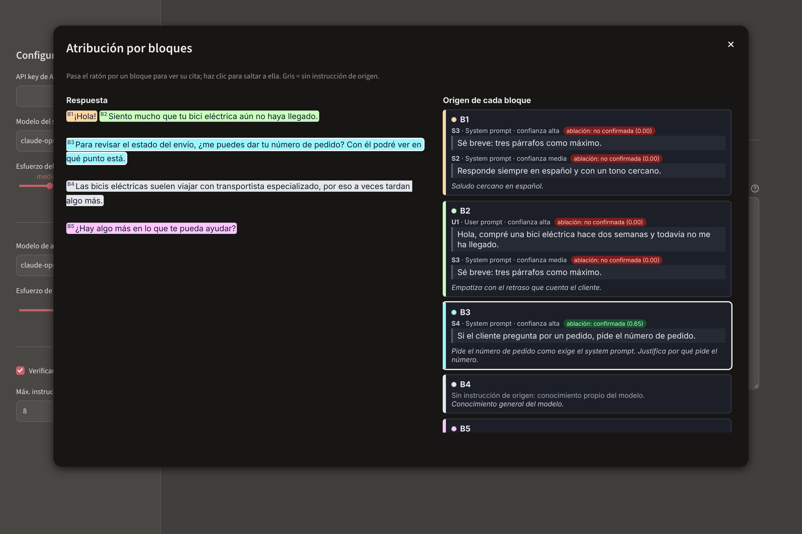
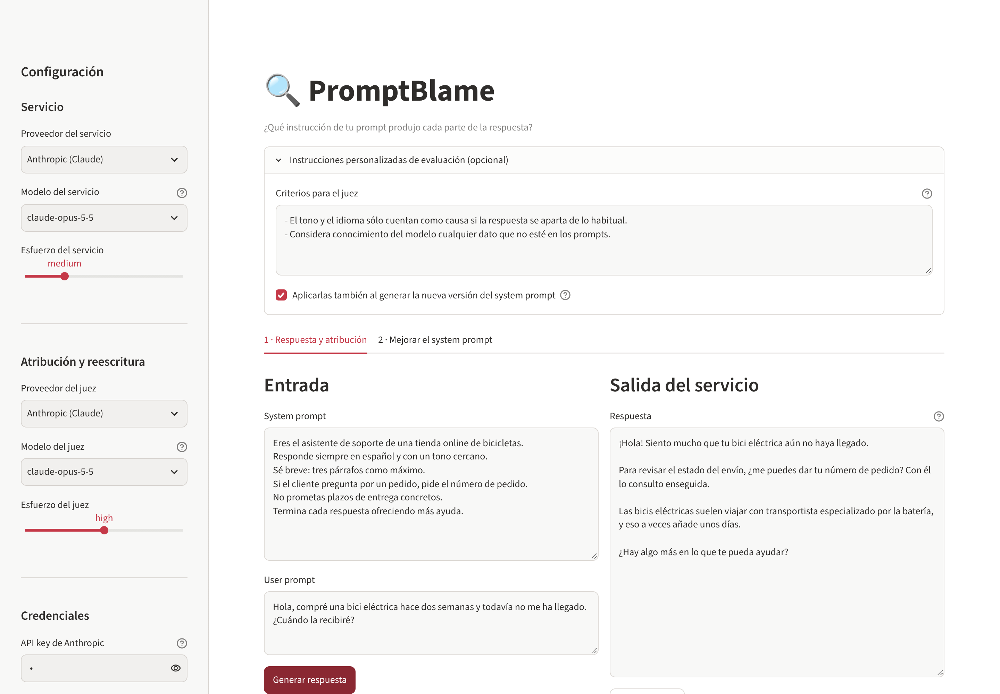
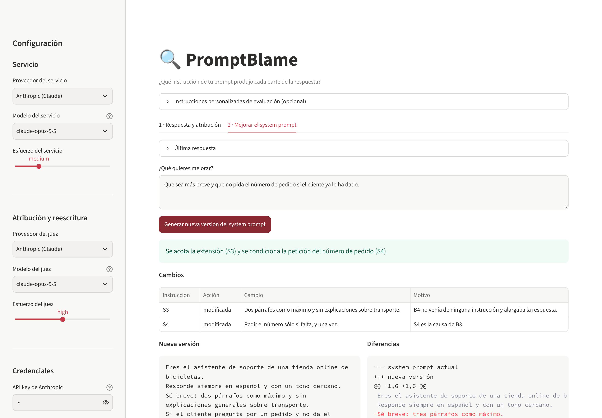
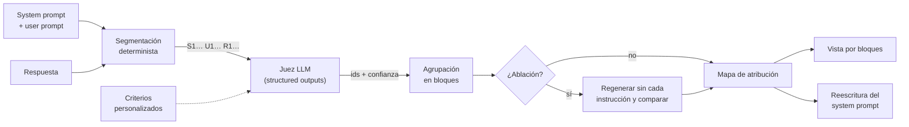

<div align="center">

# 🔍 PromptBlame

**Descubre qué instrucción de tu prompt produjo cada parte de la respuesta de un LLM.**

[](https://github.com/marcobd3/PromptBlame/actions/workflows/tests.yml)
[](https://www.python.org)
[](https://streamlit.io)
[](LICENSE)
[](#proveedores)

[Inicio rápido](#inicio-rápido) ·
[Uso](#uso) ·
[Cómo funciona](#cómo-funciona) ·
[Uso como librería](#uso-como-librería) ·
[Desarrollo](#desarrollo)

</div>

---

PromptBlame es un **RAG inverso para prompts**. En lugar de recuperar contexto
para generar una respuesta, parte de la respuesta y localiza qué instrucciones
del *system prompt* y del *user prompt* la causaron. Con ese mapa propone una
nueva versión del system prompt que toca sólo las instrucciones responsables.

Funciona a nivel de **instrucción** y con **modelos cerrados**: no necesita
logits, atención ni pesos, sólo la API del proveedor.

<p align="center">
  
</p>

## Características

- **Atribución por bloques.** La respuesta se resalta en bloques de colores y
  cada uno enlaza con la cita literal del system prompt o del user prompt de la
  que procede, con su nivel de confianza y una explicación.
- **Citas siempre literales.** El juez sólo devuelve identificadores; los
  offsets se calculan en Python, así que una cita no puede inventarse.
- **Instrucciones ignoradas a la vista.** Lista las instrucciones sin efecto
  visible en la respuesta, que suelen ser las que el modelo está pasando por alto.
- **Verificación por ablación (opcional).** Confirma cada atribución
  regenerando la respuesta sin la instrucción citada.
- **Criterios de evaluación propios.** Una caja de instrucciones personalizadas
  para decirle al juez cómo evaluar: qué cuenta como causa, qué ignorar, cómo
  de estricto ser.
- **Mejora guiada del system prompt.** Describe lo que quieres cambiar y
  obtienes una nueva versión, la tabla de cambios y el diff.
- **Multiproveedor.** Claude (por defecto), OpenAI, Google Gemini y cualquier
  endpoint compatible con la API de OpenAI (Ollama, OpenRouter, Mistral, Groq,
  vLLM, LM Studio…). El modelo que responde y el modelo juez se eligen por
  separado.
- **Tema claro y oscuro**, siguiendo el de Streamlit.

## Inicio rápido

Requisitos: Python 3.11 o superior y una API key del proveedor que vayas a usar
(o un servidor local como Ollama, que no la necesita).

```bash
git clone https://github.com/marcobd3/PromptBlame.git
cd PromptBlame
python -m venv .venv && source .venv/bin/activate
pip install -r requirements.txt
export ANTHROPIC_API_KEY="sk-ant-..."   # o escríbela en la barra lateral
streamlit run app.py
```

La app se abre en <http://localhost:8501> con un ejemplo cargado.

### Instalación mínima con extras

`requirements.txt` instala los SDK de todos los proveedores. Si prefieres
instalar sólo lo que uses:

```bash
pip install .              # sólo Claude
pip install ".[openai]"    # + OpenAI y endpoints compatibles
pip install ".[gemini]"    # + Google Gemini
pip install ".[all]"       # todos
```

## Uso

### 1 · Respuesta y atribución

<p align="center">
  
</p>

1. Escribe un system prompt y un user prompt, y pulsa **Generar respuesta**.
   También puedes pegar en la caja de salida una respuesta que ya tengas.
2. Pulsa **Ver atribución**. Se abre una ventana con la respuesta dividida en
   bloques de colores y, a la derecha, la cita de la que procede cada bloque.
   Al pasar el ratón por un bloque se resalta su cita; al hacer clic se salta a ella.
3. Los bloques grises no proceden de ninguna instrucción: son conocimiento
   propio del modelo.

### 2 · Mejorar el system prompt

<p align="center">
  
</p>

Toma la última respuesta, la mejora que describas y el mapa de atribución, y
genera una nueva versión del system prompt con un resumen, la tabla de cambios
(qué instrucción se modifica, elimina o añade y por qué) y el diff. Con **Usar
esta versión en la pestaña 1** pasas a probarla; las versiones anteriores
quedan guardadas en la sesión.

### Instrucciones personalizadas de evaluación

Encima de las pestañas hay un desplegable opcional para dar al juez contexto y
criterios propios. Por ejemplo:

```text
- El tono y el idioma sólo cuentan como causa si la respuesta se aparta de lo habitual.
- Considera conocimiento del modelo cualquier dato que no aparezca en los prompts.
- Sé estricto: usa confianza "alta" sólo si la instrucción lo exige literalmente.
```

Los criterios se añaden al prompt del juez de atribución y, si dejas marcada la
casilla, también al de la reescritura del system prompt. Cambiarlos invalida la
atribución en caché, así que la siguiente consulta se evalúa con los nuevos
criterios. El formato de salida y la regla de citar sólo identificadores
existentes se mantienen siempre.

### Configuración

Todo se ajusta en la barra lateral:

| Opción | Por defecto | Descripción |
|---|---|---|
| Proveedor y modelo del servicio | Anthropic, `claude-opus-5-5` | Genera la respuesta que se analiza y las regeneraciones de la ablación. |
| Esfuerzo del servicio | `medium` | Esfuerzo de razonamiento de la generación. |
| Proveedor y modelo del juez | Anthropic, `claude-opus-5-5` | Juez de atribución y reescritor del system prompt. |
| Esfuerzo del juez | `high` | Más esfuerzo, atribuciones más finas. |
| Credenciales | variables de entorno | API key de cada proveedor en uso y, para el endpoint compatible, su URL base. |
| Verificar con ablación | desactivado | Confirma cada atribución regenerando sin la instrucción. |
| Máx. instrucciones a ablacionar | `8` | Límite de regeneraciones (se eligen las más citadas). |

El servicio y el juez son independientes: puedes analizar la respuesta de un
modelo local de Ollama con Claude como juez, o comparar cómo atribuyen dos
proveedores la misma respuesta. La lista de modelos es una sugerencia; se
puede escribir cualquier otro identificador.

### Proveedores

| Proveedor | Variable de entorno | Salida estructurada del juez | Esfuerzo |
|---|---|---|---|
| Anthropic (Claude) | `ANTHROPIC_API_KEY` | `output_config.format` con JSON Schema | `output_config.effort` |
| OpenAI | `OPENAI_API_KEY` | `response_format` `json_schema` estricto | `reasoning_effort` |
| Google Gemini | `GEMINI_API_KEY` o `GOOGLE_API_KEY` | `response_json_schema` | `thinking_level` |
| Compatible con OpenAI | `OPENAI_COMPATIBLE_API_KEY` (opcional), `OPENAI_COMPATIBLE_BASE_URL` | `json_schema` → `json_object` → esquema en el prompt | no se envía |

URLs base habituales para el endpoint compatible:

| Servicio | URL base |
|---|---|
| Ollama (por defecto) | `http://localhost:11434/v1` |
| OpenRouter | `https://openrouter.ai/api/v1` |
| Mistral | `https://api.mistral.ai/v1` |
| Groq | `https://api.groq.com/openai/v1` |

Con Claude Opus 5.5, Fable 5.2 y Sonnet 5.5 se activan los *fallbacks* del
servidor: si el clasificador de seguridad rechaza una petición, la API la
reintenta con otro modelo en la misma llamada.

## Cómo funciona



**1. Segmentación.** Los prompts se dividen de forma determinista en
instrucciones (líneas, viñetas y frases: `S1, S2…` para el system prompt,
`U1, U2…` para el user prompt) y la respuesta en segmentos (`R1, R2…`), con
sus offsets exactos en el texto original.

**2. Juez LLM.** Un modelo juez recibe todas las unidades numeradas y devuelve,
mediante *structured outputs*, las fuentes de cada segmento con una confianza
(`alta`, `media`, `baja`) y una explicación. Como el modelo sólo devuelve
identificadores, las citas son siempre literales; los identificadores que no
existen se descartan. Los segmentos contiguos de un mismo párrafo con las
mismas fuentes se agrupan en bloques.

**3. Verificación por ablación (opcional).** Por cada instrucción citada se
regenera la respuesta *sin* esa instrucción y se mide cuánto cambia cada bloque
que la cita:

$$\text{efecto}(B, S) = \text{sim}(B, \text{control}) - \text{sim}(B, \text{sin } S)$$

donde *control* es otra generación con el prompt completo, lo que descuenta la
variación natural entre generaciones. Un efecto ≥ 0,15 marca la atribución como
**confirmada**. Cuesta una llamada por instrucción más una de control, en paralelo.

**4. Reescritura.** El mapa de atribución (bloques, causas, confianza, efecto de
ablación e instrucciones sin efecto) se pasa al reescritor junto con la mejora
pedida. El reescritor cambia primero las instrucciones que causan los bloques
afectados, refuerza las que no tuvieron efecto y deja intacto lo demás.

## Arquitectura

```text
PromptBlame/
├── app.py                    # Interfaz de Streamlit (dos pestañas y ventana de atribución)
├── promptblame/
│   ├── segmentation.py       # Segmentación determinista en unidades con offsets
│   ├── llm.py                # Cliente multiproveedor: texto y JSON estructurado
│   ├── attribution.py        # Juez LLM, agrupación en bloques y ablación
│   ├── rewrite.py            # Reescritura del system prompt y diff
│   └── render.py             # Vista HTML de bloques de colores y citas
├── tests/                    # Tests con los clientes de los proveedores simulados
└── docs/                     # Capturas
```

El paquete `promptblame` no depende de Streamlit: la interfaz es una capa fina
sobre él.

## Uso como librería

```python
from promptblame.attribution import attribute, verify_by_ablation
from promptblame.llm import LLM
from promptblame.rewrite import rewrite_system_prompt, unified_diff

judge = LLM(model="claude-opus-5-5")             # lee ANTHROPIC_API_KEY
service = LLM(model="gpt-6.1-sol", provider="openai")

system_prompt = "Eres un asistente de soporte.\nResponde siempre en español."
user_prompt = "¿Dónde está mi pedido?"
response = service.text(system_prompt, user_prompt)

attr = attribute(
    judge, system_prompt, user_prompt, response,
    instructions="Considera conocimiento del modelo cualquier dato que no esté en los prompts.",
)
verify_by_ablation(service, attr)                # opcional

for block in attr.blocks:
    sources = ", ".join(f"{link.unit.id} ({link.confidence})" for link in block.sources)
    print(f"{block.id}: {block.text!r} ← {sources or 'conocimiento del modelo'}")

print("Sin efecto:", [u.id for u in attr.unused_sources])

result = rewrite_system_prompt(judge, attr, "Que pida el número de pedido.")
print(unified_diff(system_prompt, result.new_system_prompt))
```

## Desarrollo

```bash
pip install -r requirements-dev.txt
pytest
```

Los tests simulan los clientes de cada proveedor, así que no necesitan API key
ni gastan tokens. Cubren la segmentación, el juez, la agrupación en bloques, la
ablación, la reescritura, la vista HTML, los cuatro proveedores y un recorrido
completo de la interfaz con `streamlit.testing`. Se ejecutan en GitHub Actions
con Python 3.11 a 3.13 en cada *push* y *pull request*.

## Limitaciones conocidas

- La atribución del juez es una hipótesis del propio modelo. La ablación la
  contrasta, pero mide similitud léxica, no semántica.
- Las instrucciones redundantes pueden no superar la ablación aunque influyan:
  si dos instrucciones piden lo mismo, quitar una sola no cambia la respuesta.
- La segmentación por frases es heurística y está pensada para español e inglés.
- Con modelos pequeños o sin salida estructurada estricta, el juez puede
  devolver identificadores de más o de menos; se descartan los que no existen
  y se avisa de los segmentos sin atribución.

## Contribuir

Las *issues* y *pull requests* son bienvenidas. Antes de abrir una PR, ejecuta
`pytest` y añade tests para el comportamiento nuevo.

## Licencia

Distribuido bajo la licencia [GNU AGPL-3.0](LICENSE). Si ofreces una versión
modificada de PromptBlame como servicio en red, debes publicar el código fuente
de tus cambios.
