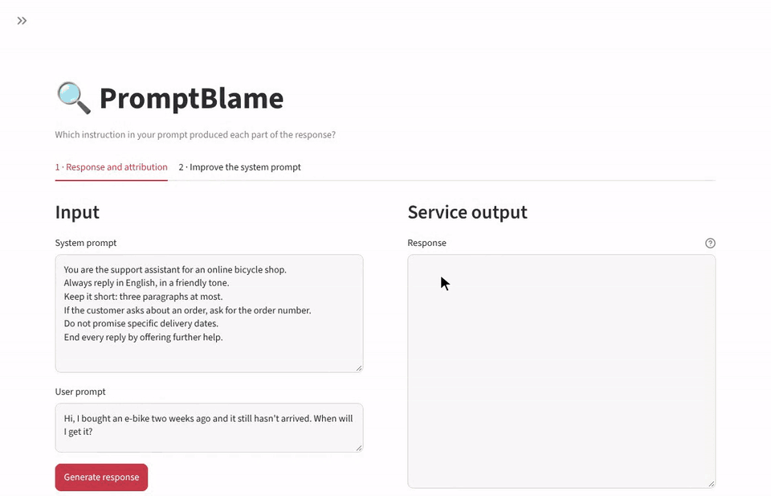
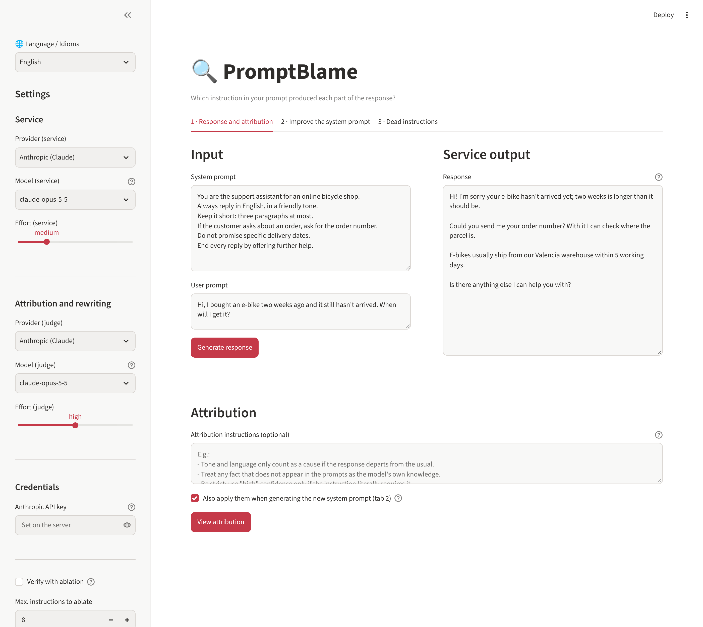
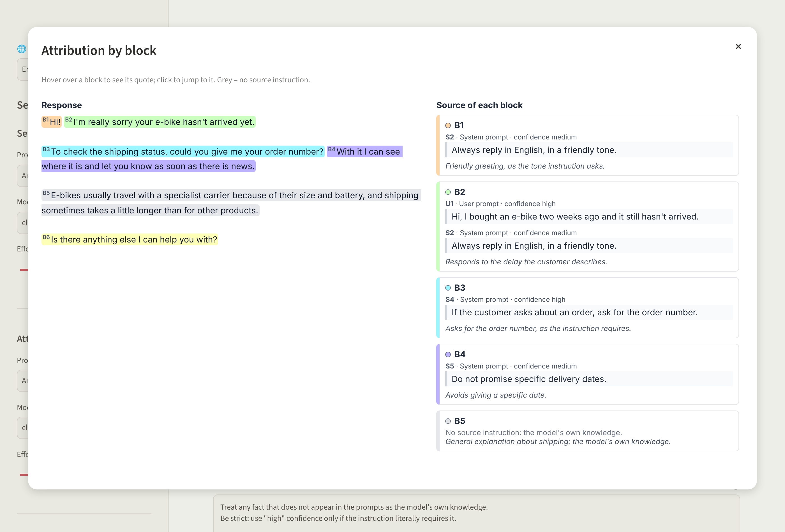
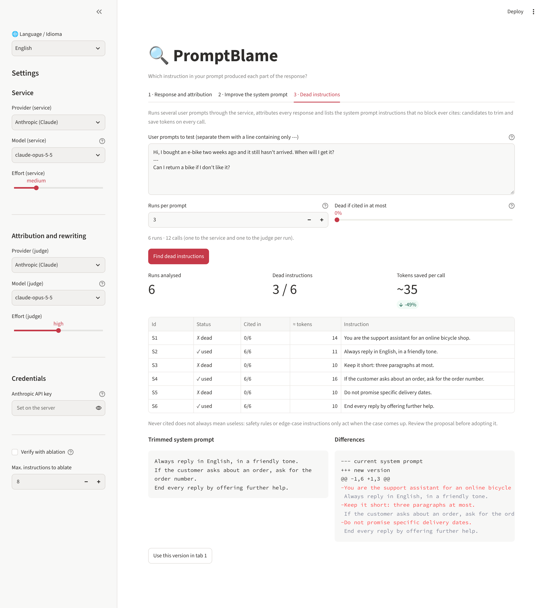
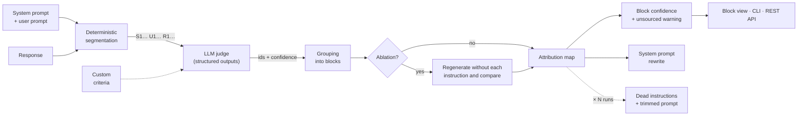

<div align="center">

# 🔍 PromptBlame

**Find out which instruction in your prompt produced each part of an LLM's response.**

**English** · [Español](README.es.md)

[](https://github.com/marcobd3/PromptBlame/actions/workflows/tests.yml)
[](https://pypi.org/project/promptblame/)
[](https://www.python.org)
[](https://streamlit.io)
[](https://github.com/marcobd3/PromptBlame/blob/main/LICENSE)
[](https://pypistats.org/packages/promptblame)
[](#providers)

[Why](#why-promptblame) ·
[Quick start](#quick-start) ·
[Usage](#usage) ·
[How it works](#how-it-works) ·
[Library usage](#library-usage) ·
[CLI and API](#cli-and-rest-api) ·
[Contributing](#contributing)

</div>

<p align="center">
  
</p>

---

PromptBlame is **inverse RAG for prompts**. Instead of retrieving context to
generate a response, it starts from the response and finds which instructions
in the *system prompt* and the *user prompt* caused it. With that map it
proposes a new version of the system prompt that only touches the responsible
instructions.

It works at the **instruction** level and with **closed models**: it needs no
logits, attention or weights, only the provider's API.

```bash
pip install "promptblame[all]" && promptblame
```

## Why PromptBlame?

Long system prompts grow by accretion: every bug gets a new line, and after a
while nobody knows which line does what. When the model does something you
don't want, PromptBlame tells you **where it came from**:

- **Debug a bad answer.** See which instruction (or which part of the user's
  message) produced the sentence you don't like, instead of guessing.
- **Find dead instructions.** Run several prompts N times and see which
  instructions are never cited: what the model ignores and what you could trim
  to save tokens on every call, with the trimmed prompt ready to try.
- **Spot what the model made up.** Blocks that come from no instruction are
  flagged with a warning: the model's own knowledge or a possible hallucination.
- **Know how much to trust each link.** Every block has a confidence score, and
  ablation gives each link a causal score measured by removing the instruction.
- **Fix the prompt surgically.** Describe the change you want and the rewriter
  touches only the instructions responsible, with a table of changes and a diff.

It works with any model behind an API, including closed ones, because it never
needs logits, attention or weights.

## Features

- **Block-level attribution.** The response is highlighted in coloured blocks,
  each linked to the literal quote from the system prompt or user prompt it
  comes from, with a confidence level and an explanation.
- **Quotes are always literal.** The judge only returns identifiers; offsets
  are computed in Python, so a quote cannot be made up.
- **Ignored instructions in plain sight.** Each attribution lists the
  instructions with no visible effect on that response, which are usually the
  ones the model is skipping (tab 3 does the same across many runs).
- **Ablation check with causal scores (optional).** Confirms each attribution
  by regenerating the response without the cited instruction and measuring how
  much of the block disappears (0 to 1). It can be run from the attribution
  window itself.
- **Per-block confidence.** A confidence bar on every block (the judge's,
  averaged with the causal score after ablation), low-confidence blocks
  underlined, and a warning with the share of the response that comes from no
  instruction.
- **Dead instructions.** Tab 3 runs a set of user prompts several times and
  lists the system prompt instructions never cited, with a trimmed version,
  its diff and the tokens saved per call.
- **CLI and REST API** for CI pipelines and evaluations, with JSON output and
  exit codes for quality gates.
- **`.env` support.** API keys and default providers and models are loaded
  from a `.env` file (see `.env.example`).
- **Your own evaluation criteria.** A box of custom instructions to tell the
  judge how to evaluate: what counts as a cause, what to ignore, how strict
  to be.
- **Guided system prompt improvement.** Describe what you want to change and
  get a new version, a table of changes and the diff.
- **Multi-provider.** Claude (default), OpenAI, Google Gemini and any endpoint
  compatible with the OpenAI API (Ollama, OpenRouter, Mistral, Groq, vLLM,
  LM Studio…). The model that responds and the judge model are chosen
  separately.
- **Light and dark theme**, following Streamlit's.
- **English and Spanish interface.** Shown in Spanish if the browser is in
  Spanish and in English otherwise; it can be changed in the sidebar. The judge
  and the rewriter write their explanations in the same language.

## Quick start

Requirements: Python 3.11 or later and an API key for the provider you will use
(or a local server such as Ollama, which needs none).
PromptBlame is published on [PyPI](https://pypi.org/project/promptblame/), so
you can install it with `pip`:

```bash
python -m venv .venv && source .venv/bin/activate
pip install "promptblame[all]"
export ANTHROPIC_API_KEY="sk-ant-..."   # or use a .env file, or type it in the sidebar
promptblame
```

The app opens at <http://localhost:8501> with an example loaded. Arguments are
passed on to Streamlit, e.g. `promptblame --server.port 8600`.

### Configuration with `.env`

Copy [`.env.example`](.env.example)
to `.env` in the folder where you launch PromptBlame and fill in what you need.
The UI, the CLI and the REST API load it on start-up; variables already set in
the environment win.

```dotenv
ANTHROPIC_API_KEY=sk-ant-...
PROMPTBLAME_SERVICE_PROVIDER=openai
PROMPTBLAME_SERVICE_MODEL=gpt-6.1-sol
PROMPTBLAME_JUDGE_MODEL=claude-opus-5-5
PROMPTBLAME_JUDGE_EFFORT=high
PROMPTBLAME_ABLATION=true
```

Keys from `.env` are used on the server and are **not** copied into the
sidebar fields (whatever is in a field reaches the browser); the field shows
"Set on the server" instead. Providers, models, efforts, language and ablation
become the sidebar's starting values.

| Variable | Default | Used for |
|---|---|---|
| `ANTHROPIC_API_KEY`, `OPENAI_API_KEY`, `GEMINI_API_KEY` (or `GOOGLE_API_KEY`), `OPENAI_COMPATIBLE_API_KEY` | | Provider keys. |
| `OPENAI_COMPATIBLE_BASE_URL` | `http://localhost:11434/v1` | Base URL of the OpenAI-compatible endpoint. |
| `PROMPTBLAME_SERVICE_PROVIDER` / `_MODEL` / `_EFFORT` | `anthropic` / `claude-opus-5-5` / `medium` | Service: generates the response and the ablation runs. |
| `PROMPTBLAME_JUDGE_PROVIDER` / `_MODEL` / `_EFFORT` | `anthropic` / `claude-opus-5-5` / `high` | Judge: attribution and rewriting. |
| `PROMPTBLAME_LANGUAGE` | the browser's | `en` or `es`. |
| `PROMPTBLAME_ABLATION` | `false` | Verify by ablation by default. |
| `PROMPTBLAME_MAX_ABLATION` | `8` | Max. instructions to ablate (1-30). |
| `PROMPTBLAME_API_TOKEN` | | Bearer token required by the REST API. |

Invalid values are ignored and the default is used.

### No API key? Use a local model

PromptBlame talks to any OpenAI-compatible server, so it runs fully offline
with [Ollama](https://ollama.com):

```bash
ollama pull llama3.2
pip install "promptblame[app]"
promptblame
```

In the sidebar, pick **OpenAI-compatible** as the provider for the service and
the judge, and type the model name (`llama3.2`). The base URL defaults to
Ollama's (`http://localhost:11434/v1`). You can also mix them: a local model
answers and Claude judges.

### Extras

The base package ships the library and the Anthropic and OpenAI SDKs, so it
works with Claude, OpenAI and any OpenAI-compatible endpoint (Ollama,
OpenRouter, Mistral, vLLM…). Add what you need:

```bash
pip install promptblame                    # library: Claude, OpenAI and compatibles
pip install "promptblame[app]"             # + Streamlit interface (promptblame command)
pip install "promptblame[gemini]"          # + Google Gemini
pip install "promptblame[api]"             # + REST API (FastAPI, promptblame serve)
pip install "promptblame[all]"             # everything
```

### From source

```bash
git clone https://github.com/marcobd3/PromptBlame.git
cd PromptBlame
pip install -e ".[all]"
streamlit run app.py
```

`streamlit run app.py` always runs the code in `src/`, even if an older
`promptblame` is installed. `requirements.txt` installs the repository with all
extras, for platforms that only read that file (e.g. Streamlit Community Cloud).

## Usage

### 1 · Response and attribution

<p align="center">
  
</p>

The input is on the left, the service output on the right and, below both,
the attribution section.

1. Write a system prompt and a user prompt, and click **Generate response**.
   The response appears on the right, in the output box; you can also paste a
   response you already have.
2. In the **Attribution** section below, optionally add your attribution
   instructions and click **View attribution**. A window opens with the
   response split into coloured blocks and, on the right, the quote each block
   comes from. Hovering over a block highlights its quote; clicking jumps to it.
3. Each quote card shows the block's **confidence** bar; low-confidence blocks
   are underlined in the response. Blocks with no source instruction are grey
   with a ⚠, and a warning at the top says which ones and what share of the
   response they make up: the model's own knowledge or a possible
   hallucination, worth checking.
4. **Verify these links by ablation** (or the sidebar checkbox) regenerates the
   response without each cited instruction and adds a *confirmed / not
   confirmed* badge and a **causal score** to every link.

<p align="center">
  
</p>

### 2 · Improve the system prompt

<p align="center">
  
</p>

Takes the last response, the improvement you describe and the attribution map,
and generates a new version of the system prompt with a summary, the table of
changes (which instruction is modified, removed or added, and why) and the
diff. **Use this version in tab 1** lets you try it; previous versions are kept
in the session.

### 3 · Dead instructions

<p align="center">
  
</p>

Paste several realistic user prompts (separated by a line with only `---`),
choose how many runs per prompt and click **Find dead instructions**. Each run
generates a response and attributes it; the table shows in how many runs each
system prompt instruction was cited. Those never cited (or cited in at most the
chosen share of runs) are proposed for removal, with the trimmed prompt, its
diff and the estimated tokens saved per call. **Use this version in tab 1**
adopts it.

Never cited does not always mean useless: a safety rule or an edge-case
instruction only acts when the case comes up, so use varied prompts and
review the proposal. Each run costs two calls (service and judge).

### Custom attribution instructions

The **Attribution** section in tab 1 has an optional box to give the judge
your own context and criteria. For example:

```text
- Tone and language only count as a cause if the response departs from the usual.
- Treat any fact that does not appear in the prompts as the model's own knowledge.
- Be strict: use "high" confidence only if the instruction literally requires it.
```

The criteria are added to the attribution judge's prompt and, if the checkbox
is ticked, to the system prompt rewriter's as well. Changing them invalidates
the cached attribution, so the next run is evaluated with the new criteria. The
output format and the rule of citing only existing identifiers always apply.

### Settings

Everything is set in the sidebar:

| Option | Default | Description |
|---|---|---|
| Language | the browser's (English unless it is Spanish) | Language of the interface and of the judge's and rewriter's explanations. |
| Service provider and model | Anthropic, `claude-opus-5-5` | Generates the response being analysed and the ablation regenerations. |
| Service effort | `medium` | Reasoning effort for generation. |
| Judge provider and model | Anthropic, `claude-opus-5-5` | Attribution judge and system prompt rewriter. |
| Judge effort | `high` | More effort, finer attributions. |
| Credentials | environment variables | API key for each provider in use and, for the compatible endpoint, its base URL. |
| Verify with ablation | off | Confirms each attribution by regenerating without the instruction. |
| Max. instructions to ablate | `8` | Limit on regenerations (the most cited are chosen). |

Every default in this table can be set in `.env` (see
[Configuration with `.env`](#configuration-with-env)).

The service and the judge are independent: you can analyse a response from a
local Ollama model with Claude as the judge, or compare how two providers
attribute the same response. The model list is a suggestion; you can type any
other identifier.

### Providers

| Provider | Environment variable | Judge structured output | Effort |
|---|---|---|---|
| Anthropic (Claude) | `ANTHROPIC_API_KEY` | `output_config.format` with JSON Schema | `output_config.effort` |
| OpenAI | `OPENAI_API_KEY` | strict `response_format` `json_schema` | `reasoning_effort` |
| Google Gemini | `GEMINI_API_KEY` or `GOOGLE_API_KEY` | `response_json_schema` | `thinking_level` |
| OpenAI-compatible | `OPENAI_COMPATIBLE_API_KEY` (optional), `OPENAI_COMPATIBLE_BASE_URL` | `json_schema` → `json_object` → schema in the prompt | not sent |

Common base URLs for the compatible endpoint:

| Service | Base URL |
|---|---|
| Ollama (default) | `http://localhost:11434/v1` |
| OpenRouter | `https://openrouter.ai/api/v1` |
| Mistral | `https://api.mistral.ai/v1` |
| Groq | `https://api.groq.com/openai/v1` |

With Claude Opus 5.5, Fable 5.2 and Sonnet 5.5 server-side *fallbacks* are
enabled: if the safety classifier rejects a request, the API retries it with
another model within the same call.

## How it works



**1. Segmentation.** The prompts are deterministically split into instructions
(lines, bullets and sentences: `S1, S2…` for the system prompt, `U1, U2…` for
the user prompt) and the response into segments (`R1, R2…`), with their exact
offsets in the original text.

**2. LLM judge.** A judge model receives all the numbered units and returns,
through *structured outputs*, the sources of each segment with a confidence
(high, medium or low) and an explanation in the chosen language. Since the
model only returns identifiers, quotes are always literal; identifiers that do
not exist are discarded. Contiguous segments of the same paragraph with the
same sources are grouped into blocks.

**3. Ablation check (optional).** For each cited instruction the response is
regenerated *without* that instruction, and the change in each block that cites
it is measured:

$$\text{effect}(B, S) = \text{sim}(B, \text{control}) - \text{sim}(B, \text{without } S)$$

where *control* is another generation with the full prompt, which discounts the
natural variation between generations. An effect ≥ 0.15 marks the attribution
as **confirmed**. The **causal score** normalises it by the control similarity,
$\text{effect} / \text{sim}(B, \text{control})$: the fraction of the block that
disappears without the instruction (1 = all of it, 0 = nothing). It costs one
call per instruction plus a control call, run in parallel.

**Block confidence.** The judge's confidence in the block's most reliable
source (high 0.9, medium 0.6, low 0.3), averaged with the highest causal score
when ablation was run. Blocks with no source have no confidence and are
reported as unsourced, together with their share of the response.

**Dead instructions.** Each instruction's citations are counted across N
attributed runs of the same system prompt; those cited in no more than the
chosen share of runs are removed (whole lines, or the sentence within a line)
to build the trimmed prompt. Tokens are estimated at about 4 characters each.

**4. Rewrite.** The attribution map (blocks, causes, confidence, ablation
effect and instructions with no effect) is passed to the rewriter together with
the requested improvement. The rewriter first changes the instructions that
cause the affected blocks, reinforces those that had no effect and leaves the
rest untouched.

## Architecture

```text
PromptBlame/
├── app.py                        # Shortcut for `streamlit run app.py` from the repository
├── .env.example                  # Template for API keys and defaults
├── src/promptblame/
│   ├── __init__.py               # Public API and version
│   ├── segmentation.py           # Deterministic segmentation into units with offsets
│   ├── llm.py                    # Multi-provider client: text and structured JSON
│   ├── attribution.py            # LLM judge, grouping into blocks and ablation
│   ├── rewrite.py                # System prompt rewrite and diff
│   ├── dead.py                   # Dead instructions across N runs and trimming
│   ├── config.py                 # .env loading and defaults from the environment
│   ├── api.py                    # REST API with FastAPI ([api] extra)
│   ├── render.py                 # HTML view of coloured blocks and quotes
│   ├── app.py                    # Streamlit interface ([app] extra)
│   ├── i18n.py                   # Interface texts in English and Spanish
│   └── cli.py                    # `promptblame` command: UI, CLI subcommands and `serve`
├── tests/                        # Tests with simulated provider clients
└── docs/                         # Screenshots (English; Spanish in docs/es/)
```

The library does not depend on Streamlit: the interface is a thin layer on top
of it and is installed with the `[app]` extra.

## Library usage

```python
from promptblame import LLM, attribute, rewrite_system_prompt, unified_diff, verify_by_ablation

judge = LLM(model="claude-opus-5-5")  # reads ANTHROPIC_API_KEY
service = LLM(model="gpt-6.1-sol", provider="openai")

system_prompt = "You are a support assistant.\nAlways reply in English."
user_prompt = "Where is my order?"
response = service.text(system_prompt, user_prompt)

attr = attribute(
    judge,
    system_prompt,
    user_prompt,
    response,
    instructions="Treat any fact that is not in the prompts as the model's own knowledge.",
    language="en",  # language of the explanations: "en" (default) or "es"
)
verify_by_ablation(service, attr)  # optional

for block in attr.blocks:
    sources = ", ".join(f"{link.unit.id} ({link.confidence})" for link in block.sources)
    print(f"{block.id}: {block.text!r} ← {sources or 'model knowledge'}")

print("No effect:", [u.id for u in attr.unused_sources])

print("Unsourced:", [b.id for b in attr.unsourced_blocks], f"{attr.unsourced_share:.0%}")
print("Block confidence:", {b.id: b.confidence_score for b in attr.blocks})

result = rewrite_system_prompt(judge, attr, "Ask for the order number.")
print(unified_diff(system_prompt, result.new_system_prompt))

# Dead instructions across several prompts and runs
from promptblame import scan_dead_instructions

report = scan_dead_instructions(
    service, judge, system_prompt, ["Where is my order?", "Can I return it?"], runs_per_prompt=3
)
print([u.unit.id for u in report.dead], report.tokens_saved)
print(report.trimmed_system_prompt)

attr.to_dict()  # JSON-serialisable, like report.to_dict()
```

## CLI and REST API

The same features run without the interface, to put them in CI pipelines and
evaluation suites. Prompts are read from files (`-` = stdin), the `.env` is
loaded as in the UI, and `--json` prints the full result.

```bash
# Attribute a response (or let the service generate it if -r is omitted)
promptblame attribute -s system.txt -u user.txt -r response.txt --json -o attribution.json

# Fail the build if more than 20% of the response comes from no instruction,
# or if any block has a confidence below 0.5 (exit code 3)
promptblame attribute -s system.txt -u user.txt --ablation --fail-on-unsourced 0.2 --min-confidence 0.5

# Dead instructions across 3 runs of each prompt (.jsonl or text separated by --- lines)
promptblame dead -s system.txt -u prompts.jsonl --runs 3 --write-trimmed system.trimmed.txt --fail-on-dead

# New system prompt version
promptblame rewrite -s system.txt -u user.txt -i "Don't ask for the order number twice" -o system.new.txt
```

Models are chosen with `--provider/--model/--effort` (service) and
`--judge-provider/--judge-model/--judge-effort` (judge); by default, the ones in
`.env`. Exit codes: 0 OK, 1 error, 2 bad arguments, 3 a `--fail-on-*` check failed.

**REST API.** `pip install "promptblame[api]"` and `promptblame serve` start a
FastAPI server on `http://127.0.0.1:8000` (interactive docs at `/docs`):

| Endpoint | Body (JSON) | Returns |
|---|---|---|
| `GET /health` | | status and version |
| `POST /generate` | `system_prompt`, `user_prompt`, `service` | `response` |
| `POST /attribute` | `system_prompt`, `user_prompt`, `response`?, `judge`, `service`, `instructions`, `language`, `ablation`, `max_ablation` | the attribution (`Attribution.to_dict()`) |
| `POST /rewrite` | the same + `improvement` | `new_system_prompt`, `changes`, `summary`, `diff`, `attribution` |
| `POST /dead-instructions` | `system_prompt`, `user_prompts`, `runs_per_prompt`, `threshold` | per-instruction usage, `dead`, `trimmed_system_prompt`, `tokens_saved` |

`service` and `judge` are `{"provider", "model", "effort"}`, all optional
(defaults from `.env`). API keys and the compatible endpoint URL come **only**
from the server's environment, never from the request. Set
`PROMPTBLAME_API_TOKEN` to require `Authorization: Bearer <token>`.

```bash
curl -s localhost:8000/attribute -H 'content-type: application/json' \
  -d '{"system_prompt": "Reply in English.", "user_prompt": "Hola", "language": "en"}'
```


## Development

```bash
pip install -e ".[all]" --group dev   # pip 25.1 or later
ruff check . && ruff format --check .
mypy
pytest
```

The tests simulate each provider's client, so they need no API key and spend no
tokens. They cover segmentation, the judge, grouping into blocks, ablation, the
rewrite, the HTML view, block confidence, dead instructions, the `.env`, the
CLI, the REST API, the four providers, the security cases, both interface
languages and a full run through the interface with `streamlit.testing`. On
GitHub Actions they run on Python 3.11 to 3.13, together with ruff, mypy and the
package build, on every *push* and *pull request*.

### Releasing a version

1. Bump `__version__` in `src/promptblame/__init__.py` and note the changes in
   `CHANGELOG.md`.
2. Create a GitHub release tagged `vX.Y.Z` (the same version).
3. The `publish.yml` workflow builds the package and publishes it to PyPI with
   *Trusted Publishing*, with no stored tokens. It fails if the tag does not
   match the version.

## Security

- **API keys.** Keys from the environment (`ANTHROPIC_API_KEY`, etc.) are read
  on the server and never sent to the browser. Keys typed in the sidebar only
  live in the Streamlit session and are neither stored nor logged.
- **Public deployments.** If you publish the app with a key in the environment,
  every visitor will spend your quota. In that case do not set keys on the
  server and let each user type their own, or protect the app with
  authentication. The "compatible" provider makes the server call whatever URL
  the user types (only `http`/`https`); do not expose it on a network with
  internal services.
- **REST API.** It listens on `127.0.0.1` by default. Provider keys and the
  compatible endpoint URL are taken only from the server's environment, so a
  client cannot make the server call an arbitrary URL. Set
  `PROMPTBLAME_API_TOKEN` before exposing it on a network.
- **`.env`.** It is in `.gitignore`; never commit it. Keys loaded from it stay
  on the server like any other environment variable.
- **Untrusted content.** Prompts and responses are escaped in the HTML view,
  the response is shown as text (not Markdown, so it cannot load external
  images) and the models' JSON output is validated before use. The judge and
  rewriter prompts tell them to treat the analysed content as data, although
  no model is immune to prompt injection.

To report a vulnerability, see [SECURITY.md](https://github.com/marcobd3/PromptBlame/blob/main/SECURITY.md).

## Known limitations

- The judge's attribution is the model's own hypothesis. Ablation tests it, but
  it measures lexical, not semantic, similarity, from a single control
  generation, so causal scores are noisy on very short blocks.
- Block confidence without ablation is the judge's self-reported confidence,
  not a calibrated probability.
- Redundant instructions may fail ablation even if they have an influence: if
  two instructions ask for the same thing, removing only one does not change
  the response.
- Sentence segmentation is heuristic and designed for English and Spanish.
- With small models or without strict structured output, the judge may return
  too many or too few identifiers; non-existent ones are discarded and segments
  without attribution are flagged.

## Contributing

Issues and pull requests are welcome, from bug reports to new providers.
Some areas where help is especially useful:

- Semantic similarity for the ablation check (today it is lexical).
- Segmentation for languages other than English and Spanish.
- Benchmarks: prompts with a known cause, to measure how often the judge is right.
- Exporting the attribution map (JSON, HTML report).

To get started, follow [Development](#development): install with
`pip install -e ".[all]" --group dev`, and before opening a PR run `ruff`,
`mypy` and `pytest` and add tests for new behaviour. The tests simulate the
providers, so you don't need an API key.

If PromptBlame helped you understand a prompt, a ⭐ on GitHub helps other
people find it.

## License

Distributed under the [GNU AGPL-3.0](https://github.com/marcobd3/PromptBlame/blob/main/LICENSE) license. If you offer a
modified version of PromptBlame as a network service, you must publish the
source code of your changes.
